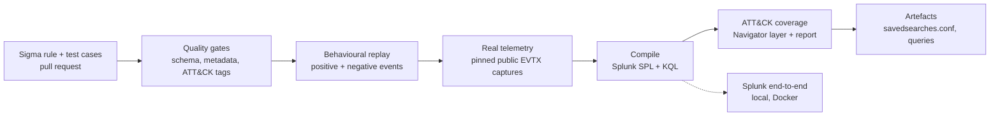

# detection-as-code

A continuous-integration pipeline for security detections. Sigma rules are written once, **tested against hand-written
events and real attack telemetry**, compiled to **Splunk SPL** and **KQL**, and mapped to **MITRE ATT&CK**,
with every change gated by automated checks.


## The problem

Most SOC detections are written directly in a SIEM console: no version history, no review, no tests and
no record of what they cover. Rules silently rot, false positives are fixed ad hoc, and nobody can say
which ATT&CK techniques are actually detected. This repo treats detections as software.

## Pipeline



## Current state

| Metric | Value |
|---|---|
| Original rules | 11 (Windows: process creation, LSASS access, Security log) |
| ATT&CK coverage | 12 techniques across 8 tactics ([report](docs/coverage.md)) |
| Automated tests | 136 (static gates, synthetic replay, real telemetry, e2e harness logic), about 2 seconds |
| Real-telemetry regression set | 15 pinned captures verified by SHA-256 in CI |
| Full sweep | all 278 public captures replayed ([report](docs/telemetry-sweep.md)) |
| Splunk SPL compiled | 11 / 11 |
| **Verified in a real Splunk 10.6** | **11 / 11 rules** and both operator-precedence probes ([results](docs/e2e-results.md)) |
| KQL (Defender XDR) compiled | 8 / 11 ([matrix](docs/conversion-matrix.md)) |

**Two findings worth reading**, both caught by testing against something real:

1. *Real attack telemetry:* my first LSASS rule allow-listed all of `System32`, hiding PowerShell and rundll32
   credential dumping. Detection of LSASS access events in the dataset went from 13/28 to 23/28 after the fix.
2. *A real Splunk:* both Windows Security rules compiled cleanly and passed every offline test, yet would never
   have fired on real Splunk data. Splunk's built-in extraction names the fields `Service_Name`,
   `Ticket_Encryption_Type` and `Failure_Code`, not the Sigma names. A field mapping in
   `pipelines/splunk_env.yml` fixed it, and the end-to-end run now passes.

Details in [design decisions](docs/design-decisions.md).

## Quick start

```bash
make setup       # create .venv and install pinned dependencies
make test        # quality gates + synthetic replay (offline)
make telemetry   # also fetch pinned public EVTX samples and replay them
make docs        # compile rules, regenerate coverage and matrix docs
make e2e-up      # start a throwaway Splunk in Docker (first start takes minutes)
make e2e         # run the compiled SPL inside Splunk and write docs/e2e-results.md
make e2e-down    # remove the container
ls build/        # compiled SPL / KQL, savedsearches.conf, ATT&CK Navigator layer
```

## Adding a detection

1. Add `rules/windows/<category>/<name>.yml` (Sigma format, with ATT&CK tags and false positives).
2. Add `tests/cases/<same-name>.yml` with at least one `positive` and one `negative` event.
3. If a public capture exercises it, add the sample to `tests/telemetry/manifest.yml` with its SHA-256.
4. `make check`. CI runs the same checks.

Example test case:

```yaml
positive:
  - name: delete all shadows quietly
    event:
      Image: 'C:\Windows\System32\vssadmin.exe'
      CommandLine: 'vssadmin.exe delete shadows /all /quiet'
negative:
  - name: listing shadows is benign
    event:
      Image: 'C:\Windows\System32\vssadmin.exe'
      CommandLine: 'vssadmin.exe list shadows'
```

## Repository layout

```
rules/       Sigma detections (original work)
tests/       quality gates, synthetic replay, real-telemetry replay, per-rule event cases
pipelines/   environment mapping (where logs live in your SIEM)
tools/       compile, coverage, EVTX parsing/replay, sample fetching, dataset sweep, Splunk e2e runner
e2e/         throwaway Dockerised Splunk used by the end-to-end test
docs/        generated coverage + conversion matrix; sweep report; design decisions
.github/     CI workflow
```

## Design decisions and limitations

See [docs/design-decisions.md](docs/design-decisions.md). Highlights: the Splunk end-to-end test uses classic
WinEventLog text for Security events and JSON for Sysmon-style events, so Sysmon field names are assumed to
match your Sysmon add-on; KQL output is not yet tested in a live Sentinel or Defender; the Kerberoasting rule
has no public capture and is validated with synthetic events only; and rules are `experimental` and untuned.

## Roadmap

- [x] Rule schema and ATT&CK tagging gates
- [x] Behavioural replay tests (positive and negative events)
- [x] Compile to Splunk SPL and KQL, with conversion matrix
- [x] ATT&CK Navigator coverage layer
- [x] Replay real telemetry from public attack captures; full-dataset sweep
- [x] End-to-end test in a real Splunk (Docker): 11/11 rules, plus operator-precedence probes
- [ ] Run the Splunk end-to-end test in CI (manual-trigger workflow first)
- [ ] Deploy stage: push `savedsearches.conf` to Splunk via REST on merge
- [ ] Sentinel `SecurityEvent` target; expand to 25+ rules incl. Linux and cloud
- [ ] Pin GitHub Actions to commit SHAs; add dependency scanning

## Credits

Built on [Sigma](https://github.com/SigmaHQ/sigma), [pySigma](https://github.com/SigmaHQ/pySigma) and
[MITRE ATT&CK](https://attack.mitre.org/). Real telemetry comes from the public
[EVTX-ATTACK-SAMPLES](https://github.com/sbousseaden/EVTX-ATTACK-SAMPLES) dataset (GPL-3.0), fetched at test
time and never redistributed here. Detection logic is original, informed by public technique write-ups
listed in each rule's `references`.

## License

MIT
