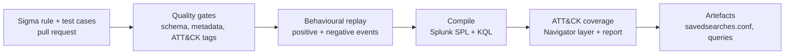

# detection-as-code

A CI/CD pipeline for security detections. Sigma rules are written once, **tested against known-good and
known-benign events**, compiled to **Splunk SPL** and **KQL**, and mapped to **MITRE ATT&CK**, with every
change gated by automated checks.


## The problem

Most SOC detections are written directly in a SIEM console: no version history, no review, no tests and
no record of what they cover. Rules silently rot, false positives are fixed ad hoc, and nobody can say
which ATT&CK techniques are actually detected. This repo treats detections as software.

## Pipeline



## Current state

| Metric | Value |
|---|---|
| Original rules | 8 (Windows: process creation, LSASS access, Security log) |
| ATT&CK coverage | 10 techniques across 7 tactics ([report](docs/coverage.md)) |
| Automated tests | 77, running in under a second |
| Splunk SPL compiled | 8 / 8 |
| KQL (Defender XDR) compiled | 5 / 8 ([matrix](docs/conversion-matrix.md)) |

## Quick start

```bash
make setup      # create .venv and install pinned dependencies
make test       # quality gates + behavioural replay
make docs       # compile rules, regenerate coverage and matrix docs
ls build/       # compiled SPL / KQL, savedsearches.conf, ATT&CK Navigator layer
```

## Adding a detection

1. Add `rules/windows/<category>/<name>.yml` (Sigma format, with ATT&CK tags and false positives).
2. Add `tests/cases/<same-name>.yml` with at least one `positive` and one `negative` event.
3. `make check`. CI runs the same command.

Example test case:

```yaml
positive:
  - name: delete all shadows quietly
    event:
      Image: 'C:\Windows\System32\vssadmin.exe'
      CommandLine: 'vssadmin.exe delete shadows /all /quiet'
negative:
  - name: listing shadows is benign
    event:
      Image: 'C:\Windows\System32\vssadmin.exe'
      CommandLine: 'vssadmin.exe list shadows'
```

## Repository layout

```
rules/       Sigma detections (original work)
tests/       quality gates, behavioural replay harness, per-rule event cases
pipelines/   environment mapping (where logs live in your SIEM)
tools/       compile (convert.py) and coverage (coverage.py)
docs/        generated coverage + conversion matrix; design decisions
.github/     CI workflow
```

## Design decisions and limitations

See [docs/design-decisions.md](docs/design-decisions.md). Highlights: the tests validate rule *logic*
(not yet backend translation against a live SIEM), Security-log field names need verifying against your own
Splunk TA configuration, and rules are `experimental` and untuned.

## Roadmap

- [x] Rule schema and ATT&CK tagging gates
- [x] Behavioural replay tests (positive and negative events)
- [x] Compile to Splunk SPL and KQL, with conversion matrix
- [x] ATT&CK Navigator coverage layer
- [ ] Replay real telemetry: public attack-sample datasets as regression fixtures
- [ ] End-to-end test against a containerised Splunk (ingest events, run compiled SPL, assert hits)
- [ ] Deploy stage: push `savedsearches.conf` to Splunk via REST on merge
- [ ] Sentinel `SecurityEvent` target; expand to 25+ rules incl. Linux and cloud
- [ ] Pin GitHub Actions to commit SHAs; add dependency scanning

## Credits

Built on [Sigma](https://github.com/SigmaHQ/sigma), [pySigma](https://github.com/SigmaHQ/pySigma) and
[MITRE ATT&CK](https://attack.mitre.org/). Detection logic is original, informed by public technique
write-ups listed in each rule's `references`.

## License

MIT
